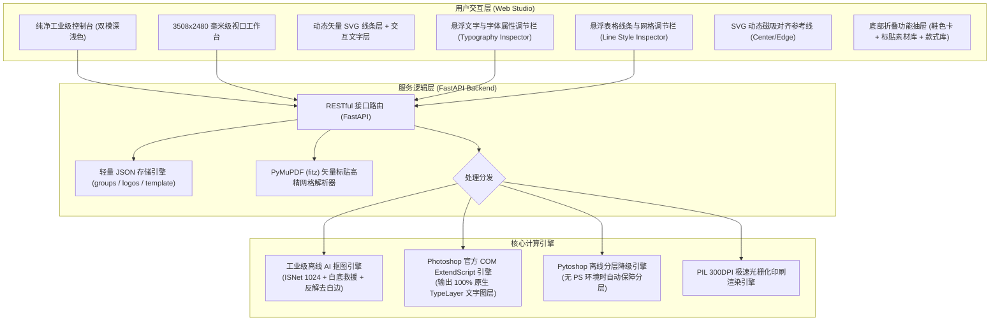

# 软件架构设计说明书 (Software Design Description, SDD)

**项目名称**：鞋样送审图稿制作系统 (PSDweb)  
**当前版本**：`v2.4.0 Pro`  
**文档密级**：通用脱敏交付级 (适用于外部团队接入、客户交付与二次开发)  
**运行平台**：Windows 10 / 11 x64 (免安装零环境依赖绿色运行)  

---

## 1. 系统概述与脱敏声明

### 1.1 系统定位
本系统是专为鞋类制造、贸易商及研发中心打造的一站式鞋样送审图稿与工程文件自动化生产平台。系统支持：
- 批量鞋款资料与多配色管理；
- 离线工业级高精度 AI 抠图去底；
- 人体工学标贴智能排版与动态 CAD 磁吸辅助对齐；
- **底表模版全面可视化深度编辑**：文字内容、字体族、字号、粗细、颜色、表格线条与分割线位置均可在线自定义并持久化；
- **双模高精输出**：一键生成 **300DPI 印刷级送审大图 (JPEG)** 与 **Photoshop 100% 原生可编辑文字分层工程文件 (PSD)**；
- **品牌标贴与图案素材库**：内置 112 款品牌官方图案与核心主标，支持分类检索、模糊搜索与本地 PDF 随时提取入库；
- 局域网多机协同与 AI 开放接口。

### 1.2 脱敏规范声明
本设计说明书及工程源码已执行严格的企业级脱敏处理：
1. **路径解耦**：移除所有本地个人用户名、私人磁盘盘符及绝对路径，全系统统一采用基准宏 `<PROJECT_ROOT>` 与标准相对路径；
2. **网络隔离**：去除任何绑定私网的硬编码，网络监听统一绑定 `0.0.0.0:8765`，动态嗅探本机局域网 IP (`http://<LAN_IP>:8765`) 提供协同；
3. **品牌与资产解耦**：表头标题、品牌商标 LOGO、鞋舌/侧身标贴及款式参数均抽象为外部可配置 JSON 与资产槽位，支持任意代工厂或自主品牌灵活置换。

---

## 2. 总体架构设计

系统采用 **“轻量极简本地服务 (Local Server) + 现代响应式 Web 工作台 (Web Studio) + 原生便携执行引擎 (Portable Runtime)”** 的三层架构：

---

## 3. 核心子系统与关键设计细节

### 3.1 Photoshop 原生可编辑文字图层 (Live TypeTool PSD)
传统 pure-python PSD 库无法正确生成 Adobe 复杂的 `TySh` / `EngineData` 矢量文字数据结构。本系统采用 **Windows COM ExtendScript 动态代码生成方案**：
1. **Unicode 安全转义**：针对 Windows COM ANSI 默认代码页易导致中文乱码问题，所有中文字符在传输前均转义为 `\uXXXX` 格式；
2. **原生 TypeTool 声明**：通过 `layer.kind = LayerKind.TEXT` 创建真正的 Photoshop 原生文字图层，并动态绑定字体族（如 `MicrosoftYaHei`、`SimHei`、`SimSun` 等 PostScript 名称）、字号点数与 RGB 颜色；
3. **图层分组架构**：
   - `【底表文字与规格信息】`：存放表头标题、品类名称、审核复核、面料材质、鞋底材质、左侧10行工单标签名与各工单数值；
   - `【底表线框与底板】`：存放矢量线条层与品牌主 LOGO；
   - `【款式 X (颜色)】`：为每只鞋款建立独立分组，内含独立颜色标注文字图层、透明鞋体图层及所附标贴图层。
4. **设计师操作体验**：在 Adobe Photoshop 中打开导出的 PSD 文件后，使用快捷键 `T`（文字工具）直接双击任意文字，即可像在办公软件中一样直接修改文本、更换字体或修改大小，无需重排。

### 3.2 底表模版全面可视化深度编辑机制
系统突破了以往只能更换表头标题的限制，实现了全底表属性的完全解耦与可视化：
1. **配置驱动模型 (`template_config.json`)**：
   - `fonts`：定义标题、品类、表格文字、标签字段、鞋款颜色标注的字体、字号、加粗、颜色；
   - `lines`：定义外边框粗细、内网格粗细、线条颜色、左侧表格分割线 X 坐标；
   - `labels`：定义货号、季节、工艺、类别、楦型、尺码、面料、鞋底等所有字段名称；
2. **实时双向绑定**：前端页面点击任意文字元素即触发 `openTypoBar`，在浮动属性栏中调节字号、粗细或字体时，工作台画布立即实时重绘反馈，点击“保存模版”一键持久化至后端。

### 3.3 品牌标贴与图案素材库 (Brand Assets & Logo Hub)
为解决鞋类研发过程中官方标贴繁杂散乱的问题，系统建立了标准的标贴资产中心：
1. **PDF 矢量手册高精提取流水线**：
   - 集成 `pymupdf` (fitz) 高清解析器；
   - 对 4 列 × 3 行排版的品牌手册进行几何计算，以 150 DPI 光栅化并自动截取图案与编号；
   - 过滤白色背景像素（`R,G,B > 238` 设为完全透明），输出 0 杂色黑边的高清透明 PNG 标贴；
2. **多维分类与实时索引**：
   - 分类体系：`全部`、`常用核心标`、`22SS官方库`、`自定义`；
   - 毫秒级前端实时模糊搜索，输入任意编号或拼音即可快速定位；
   - 点击标贴卡片即可自动添加至当前选中的鞋款上，并支持拖拽物理吸附对齐。

---

## 4. 接口规约 (API Specifications)

### 4.1 底表模版接口
- `GET /api/template-config`：获取当前生效的底表模版参数；
- `POST /api/template-config`：更新模版配置（含文字、字体、线条、标签名）；
- `POST /api/template-config/upload-logo`：上传并更换品牌主 LOGO；
- `POST /api/template-config/reset`：一键恢复系统原厂标准模版。

### 4.2 标贴素材库接口
- `GET /api/logos?category={cat}&q={query}`：检索标贴素材列表；
- `POST /api/logos`：上传新增单张标贴；
- `PUT /api/logos/{id}`：编辑标贴元数据；
- `DELETE /api/logos/{id}`：删除自定义标贴；
- `POST /api/logos/import-pdf`：批量扫描本地矢量 PDF 手册自动提取并入库。

### 4.3 渲染与导出接口
- `POST /api/render`：单款送审单高精渲染（同步输出 300DPI JPG 与原生文字 PSD）；
- `POST /api/batch-render-all`：整批次工单多款式并发批量导出；
- `GET /api/download/{filename}`：下载成品文件；
- `GET /api/open-folder`：调用系统资源管理器弹出成果文件夹。

---

## 5. 版本迭代与归档规范

系统遵循严格的语义化版本号管理 (`MAJOR.MINOR.PATCH`)：
1. **版本号文件**：根目录下唯一的 `VERSION` 文件为全局权威版本号（当前 `v2.4.0`）；
2. **打包归档机制 (`package_tool.py`)**：
   - 打包前自动扫描根目录历史发布压缩包，创建 `archive/backup_releases_{timestamp}/` 独立文件夹进行安全归档；
   - 自动在 `backups/backup_{version}_{timestamp}/` 创建当前源码与配置的快照镜像；
   - 使用 Python 内置 `zipfile` 进行绿色便携包输出，文件名统一采用 `小帆船送审系统_{version}_{timestamp}.zip`。
